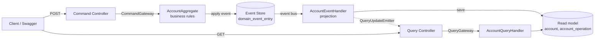

# es-cqrs-axon

Bank account demo using **Event Sourcing** and **CQRS** with **Axon Framework**, Spring Boot 3 and PostgreSQL.

Every change is stored as an immutable **event**. The current state is rebuilt from those events, and a separate **read model** serves the queries.

## Architecture



| Side | Role | Components |
|---|---|---|
| Command (write) | Validate rules, emit events | `@CommandHandler`, `@EventSourcingHandler`, event store |
| Query (read) | Project events, answer reads | `@EventHandler`, `@QueryHandler`, JPA repositories |

## Stack

Java 21, Spring Boot 3.4, Axon Framework 4.10, PostgreSQL, Docker Compose, springdoc (Swagger), Lombok.

## Run

```bash
docker compose up -d      # PostgreSQL + pgAdmin
./mvnw spring-boot:run    # app on http://localhost:8066
```

- Swagger: `http://localhost:8066/swagger-ui.html`
- pgAdmin: `http://localhost:8088` (host `postgres`, db `es-accounts_db`)

## Endpoints

| Method | Path | Description |
|---|---|---|
| POST | `/commands/account/add` | Create account (emits Created + Activated) |
| POST | `/commands/account/credit` | Credit account |
| POST | `/commands/account/debit` | Debit account (needs enough balance) |
| PUT | `/commands/account/updateStatus` | Change account status |
| GET | `/commands/account/events/{id}` | Read the events of an account |
| GET | `/query/accounts/all` | List all accounts |
| GET | `/query/accounts/accountStatement/{id}` | Account + its operations |
| GET | `/query/watch/{id}` | Live stream (SSE) of new operations |

## Business rules

- Initial balance and amounts must be positive.
- Credit and debit are allowed only if the account is `ACTIVATED`.
- Debit is refused if the balance is insufficient (no event is stored).

## Events

`AccountCreatedEvent`, `AccountActivatedEvent`, `AccountCreditedEvent`, `AccountDebitedEvent`, `AccountStatusUpdatedEvent`

## Structure

```
com.example.demo
├── command/   aggregates, commands, controllers, dtos
├── query/     entities, repository, handlers, queries, controllers
├── events/    shared events
└── enums/     AccountStatus, OperationType
```

## Screenshots

Add here: Swagger UI, `domain_event_entry` table in pgAdmin, `/query/watch` live stream.

## Credits

Based on the course by Prof. Mohamed Youssfi (ENSET Mohammedia).